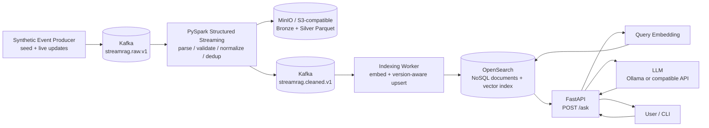

# StreamRAG — Kế hoạch Milestone 1 (nhóm 5 người)

> **Topic:** StreamRAG: Real-Time Retrieval-Augmented Generation over Continuous Data Streams  
> **Repository:** https://github.com/thanhlamauto/BigData_Project_Group10  
> **Milestone 1:** *Git is ready with executable code; data and system architecture must be ready also.*  
> **Trạng thái khảo sát (25/10/2026):** Repository công khai **chưa có commit/source code** (GitHub trả về “This repository is empty”). Đây là kế hoạch **triển khai**, không phải báo cáo các đầu việc đã hoàn thành.  
> **Thời lượng đề xuất:** **14 ngày, 26/10–08/11/2026** (giả định để chia việc; không phải deadline đã xác nhận với giảng viên).  
> **Nhân sự:** 5 người, ký hiệu TV1–TV5; thay bằng tên/GitHub username sau buổi kickoff.

## 1. Mục tiêu và giới hạn milestone

### 1.1. Mục tiêu cuối cùng

Xây dựng **minimum executable vertical slice** của hệ thống StreamRAG: nhóm có thể clone repo trên một máy mới, dựng hệ thống, đẩy **sự kiện mới** vào stream, quan sát sự kiện được xử lý/lưu trữ/đánh chỉ mục, rồi đặt câu hỏi và nhận câu trả lời dựa trên dữ liệu vừa cập nhật **kèm nguồn truy xuất**.

Luồng cần chứng minh:

**Producer → Kafka → PySpark Structured Streaming → MinIO (Parquet) + Kafka cleaned topic → Embedding/Indexer → OpenSearch → Retrieval → LLM → API response.**

Điểm phân biệt StreamRAG với RAG truyền thống: **không phải chỉ nạp sẵn tài liệu một lần**; dữ liệu tiếp tục đến sau khi các service đã khởi động và có thể xuất hiện trong kết quả truy vấn **không cần restart/rebuild thủ công**.

### 1.2. Phạm vi ưu tiên

| Ưu tiên | Phải có / Nên có | Quyết định |
|---|---|---|
| **P0 — bắt buộc** | Repo runnable, README/setup, `.env.example`, data generator + fixtures, sơ đồ kiến trúc, Kafka producer, Spark streaming, một nơi lưu raw/processed, vector retrieval, API, tích hợp tối thiểu, script demo | **Cam kết Milestone 1** |
| **P1 — nên có** | Chống duplicate, update theo `version`, xử lý một số bản ghi trễ, log/metrics cơ bản, smoke test tự động, thử nghiệm latency và restart recovery | Làm sau khi P0 chạy ổn |
| **P2 — để milestone sau** | Multi-source production, advanced window/join/optimization, full exactly-once proof, autoscaling, dashboard đẹp, K8s production, benchmark lớn, tuning RAG/LLM sâu | **Không** được chặn Milestone 1 |

**Chú ý:** `LLM mock` chỉ phục vụ test offline. Để tuyên bố đã có RAG end-to-end, demo phải chạy **ít nhất một lần với LLM thật** (Ollama local hoặc API cấu hình qua environment); nếu chưa được thì báo cáo rõ là chỉ có retrieval + mock generation.

### 1.3. Những điểm phải bám theo đề cương môn

Tài liệu môn yêu cầu một **Lambda/Kappa Architecture** và end-to-end processing; các công nghệ chính gồm **Spark, message queue, NoSQL, HDFS hoặc lưu trữ tương đương, Kubernetes/Cloud**. Ngoài ra còn có các kỹ năng Spark nâng cao, streaming, data quality và fault tolerance. Vì vậy:

- **Chọn Kappa Architecture**: một đường xử lý sự kiện liên tục, Kafka giữ vai trò event log; không tạo riêng batch layer ở M1.
- **Kafka + Spark Structured Streaming** là lõi Big Data, **không để dự án biến thành FastAPI + vector DB đơn thuần**.
- **OpenSearch** vừa đóng vai trò document-oriented **NoSQL/search store**, vừa lưu embeddings để vector search.
- **MinIO/S3-compatible storage** lưu file Parquet để minh họa phân tầng dữ liệu. **MinIO single-node trên Docker là bản chạy local, chưa tự chứng minh storage phân tán**; ở milestone sau cần triển khai HDFS/distributed object storage hoặc cloud S3, và xác nhận với giảng viên công nghệ nào được chấp nhận là “equivalent”.
- **Docker Compose** là môi trường chạy lại dễ dàng cho M1, **không thay thế** yêu cầu Kubernetes/Cloud cho toàn đồ án. Lưu quyết định chuyển sang K8s/Cloud trong ADR/deployment plan.

## 2. Use case và kiến trúc đề xuất

### 2.1. Chốt use case nhỏ nhưng đúng bản chất streaming

**Use case đề xuất:** Hệ thống hỏi đáp về **incident/status updates của các dịch vụ giả lập** (ví dụ Atlas Search, Payment API, Data Gateway). Mỗi service có những thông báo mới và bản sửa đổi trạng thái. Người dùng hỏi “Atlas Search đang bảo trì lúc mấy giờ?”; sau khi nhận thông báo cập nhật qua Kafka, câu trả lời phải phản ánh **bản mới nhất**.

Lý do chọn: dễ sinh dữ liệu có ground truth, dễ kiểm tra **freshness**, **duplicate**, **late event**, **revision**, không phụ thuộc vào API tin tức ngoài hay quyền dùng dữ liệu bên thứ ba. Có thể bổ sung RSS/news source ở milestone sau.

### 2.2. Sơ đồ kiến trúc logic (dùng được trực tiếp trên GitHub)



**Kappa:** Kafka là event log chính; một streaming computation xử lý từng bản ghi. Có thể phát lại sự kiện từ Kafka (trong thời hạn retention) để tái tạo downstream index, nhưng chưa cần separate batch pipeline.

**Hai đường phục vụ:**
1. **Write/ingestion path:** producer → Kafka → Spark → Parquet và cleaned topic → indexer → OpenSearch.
2. **Read/query path:** API → encode query → OpenSearch top-k → ghép context → LLM → câu trả lời + trích dẫn metadata.

**Ràng buộc quan trọng:** ghi vào cả Parquet và Kafka không phải một distributed transaction. Các Kafka/Spark sink có thể **at-least-once**, cần `event_id`/`document_id` và idempotent upsert để retry không nhân đôi dữ liệu. **Không tuyên bố exactly-once end-to-end** trong M1 nếu chưa đo/kiểm chứng đầy đủ.

### 2.3. Technology decisions (đóng băng ở ngày 2)

| Thành phần | Công nghệ đề xuất | Việc phải chạy được ở M1 | Ghi chú |
|---|---|---|---|
| Event generator | Python | Seed dữ liệu + phát sự kiện mới mỗi vài giây | Dữ liệu deterministic theo `seed` |
| Event broker | Apache Kafka (KRaft) | 2 topics `raw` / `cleaned` | Khóa message bằng `document_id` |
| Stream processing | PySpark Structured Streaming | Read Kafka, parse JSON schema, validate, normalize, de-dup cơ bản | Pin Spark/Kafka connector **cùng phiên bản tương thích** |
| Data lake | MinIO (S3 API), file Parquet | Bronze/Silver + checkpoint | Local single node; distributed/cloud ở giai đoạn sau |
| Search/NoSQL | OpenSearch | 1 document index có vector + metadata | Thiết lập `knn_vector` đúng embedding dimension |
| Embedding | `sentence-transformers` (chọn model nhỏ hỗ trợ ngôn ngữ dữ liệu) | Worker tính embedding và query encode **cùng model** | Không chạy model trong mỗi Spark UDF ở M1 |
| Application | FastAPI + Python client | `/health`, `/ask` | Trả về `sources` có `document_id/version` |
| LLM | Ollama **hoặc** API OpenAI-compatible được cấu hình | 1 đường chạy LLM thật; `mock` cho automated test | Không commit API key |
| Dev deployment | Docker Compose + Makefile | `make up`, `make seed`, `make smoke` | Có resource profile `lite` nếu máy yếu |
| CI | GitHub Actions | format/lint + unit tests | Full multi-container smoke chạy local nếu CI runner thiếu RAM |

**Tài nguyên:** Base stack Kafka + Spark + MinIO + OpenSearch + indexer có thể nặng; dự trù **máy 16 GB RAM (tùy image và cấu hình)**, chạy Ollama nên có nhiều RAM hơn hoặc dùng API ngoài. Nếu chỉ có máy 8 GB, cần thử profile nhẹ **trước ngày 4** và ghi rõ giới hạn; không cam kết full stack chạy tốt trên 8 GB khi chưa benchmark.

## 3. Data plan — “data must be ready”

### 3.1. Bộ dữ liệu phải bàn giao

- `data/sample/seed_events.jsonl`: khoảng **300–500 bản ghi giả lập**, đủ để retrieval có ý nghĩa.
- `scripts/generate_data.py`: sinh dữ liệu với random seed cố định, tái tạo được toàn bộ fixtures.
- `scripts/stream_simulator.py`: publish theo `N events/s`; cho phép đẩy **live update** sau khi hệ thống chạy.
- `data/sample/test_cases.jsonl`: ít nhất **20 câu hỏi** có `expected_document_id` và `expected_facts` (10 câu về seed, 10 câu về stream/update).
- `data/README.md`: ý nghĩa trường dữ liệu, nguồn gốc, license (synthetic, do nhóm tự tạo), số lượng, cách replay, kiểm thử chất lượng.
- Bộ trường hợp góc: **10 duplicate events, 5 late events, 5 version updates, 5 invalid events**. Các số này là mục tiêu thiết kế dữ liệu; không phải dữ liệu sẵn có.

### 3.2. Hợp đồng message (chốt trước khi code các module)

```json
{
  "schema_version": 1,
  "event_id": "evt-000501",
  "document_id": "inc-atlas-001",
  "version": 2,
  "operation": "upsert",
  "source": "synthetic-status",
  "source_url": null,
  "title": "Atlas Search maintenance update",
  "body": "The maintenance start time changed from 20:30 to 21:30 UTC.",
  "category": "maintenance",
  "event_time": "2026-10-27T09:00:00Z",
  "ingested_at": "2026-10-27T09:00:03Z"
}
```

**Quy ước bắt buộc:**

- `event_id`: định danh *một sự kiện duy nhất*, dùng chống duplicate khi retry.
- `document_id`: định danh tài liệu/trạng thái logic, **giữ nguyên khi update**.
- `version`: số nguyên tăng dần; bản version mới phải thay thế bản cũ khi truy vấn. Không để late version ghi đè version mới.
- `event_time`: thời điểm sự kiện xảy ra; `ingested_at`: thời điểm producer nạp lên hệ thống. Đồng bộ UTC ISO 8601.
- `operation`: M1 chỉ cần hỗ trợ `upsert`; `delete/tombstone` để phase sau nếu thiếu thời gian.
- Nếu `source_url` là null, trích dẫn **`document_id`, `title`, `event_time`**, không bịa URL.
- **M1 chọn 1 document = 1 searchable chunk** (dữ liệu ngắn). Đa chunk/long-document reindexing là backlog để giảm phức tạp cập nhật phiên bản.

### 3.3. Data quality tối thiểu

1. Bỏ message JSON/schema lỗi, ghi số bản ghi lỗi vào log/counter (không để crash cả stream).
2. Chuẩn hóa khoảng trắng, bỏ `body` rỗng, chuẩn hóa timestamp.
3. Xử lý duplicate bằng ID/watermark hoặc version-aware idempotency; mô tả rõ giới hạn của watermark trong tài liệu.
4. Với update, chỉ hiển thị bản `version` mới nhất trên OpenSearch. Kiểm tra query không còn trả lại nội dung cũ.
5. Có Parquet output theo ngày ingestion (`ingest_date`) và checkpoint có thể khởi động lại.

## 4. Repo structure mong muốn

```text
BigData_Project_Group10/
├── README.md
├── LICENSE                         # nếu nhóm quyết định phát hành giấy phép
├── .gitignore
├── .env.example                    # biến cấu hình, KHÔNG chứa secrets
├── Makefile
├── pyproject.toml                  # hoặc requirements/*.txt, pin version
├── infra/
│   ├── compose.yaml
│   ├── kafka/                       # topic bootstrap script
│   ├── minio/                       # bucket init
│   └── opensearch/                  # mapping + index init
├── data/
│   ├── README.md
│   ├── contracts/event.schema.json
│   └── sample/
│       ├── seed_events.jsonl
│       └── test_cases.jsonl
├── scripts/
│   ├── generate_data.py
│   ├── stream_simulator.py
│   └── smoke_test.py
├── services/
│   ├── producer/
│   ├── stream_processor/            # PySpark job Kafka -> Parquet + cleaned Kafka
│   ├── indexer/                     # Kafka consumer -> embeddings -> OpenSearch
│   └── api/                         # FastAPI retrieval + generation
├── tests/
│   ├── unit/
│   └── integration/
├── docs/
│   ├── architecture.md
│   ├── diagrams/                    # nếu cần SVG/PNG ngoài Mermaid
│   ├── data_contract.md
│   ├── runbook.md
│   ├── adr/0001-kappa-stack.md
│   └── milestone_1_evidence.md
├── deploy/
│   └── k8s/                         # M1: outline/manifest khởi đầu (không hứa production)
└── .github/
    ├── workflows/ci.yaml
    └── pull_request_template.md
```

**Chỉ tạo các file thực sự dùng.** Không viết hàng loạt folder rỗng, không push checkpoint/data lake runtime hoặc `.env` thật vào Git. Dataset mẫu nhỏ có thể commit; dữ liệu sinh lớn cần script tái tạo và được ignore.

## 5. Phân công 5 người và đầu ra phải review được

| Thành viên | Vai trò chính | Trách nhiệm P0 | File/đầu ra chủ sở hữu | Reviewer chéo |
|---|---|---|---|---|
| **TV1** | Lead / Architecture / DevOps / integration | Scope, ADR Kappa, repo skeleton, Compose/Makefile, CI, README, demo integration | `docs/architecture.md`, `infra/compose.yaml`, `Makefile`, `README.md`, `.github/` | TV3 |
| **TV2** | Data & Kafka ingestion | Data contract, synthetic dataset, producer, Kafka topics, replay/live injection, edge-case fixtures | `data/`, `scripts/generate_data.py`, `scripts/stream_simulator.py`, `services/producer/` | TV3 |
| **TV3** | Spark & Data Lake | PySpark streaming Kafka source, validation/normalization, Parquet Bronze/Silver, cleaned topic, checkpoint | `services/stream_processor/`, MinIO read/write configs | TV2 |
| **TV4** | Vector/NoSQL & indexing | OpenSearch mapping, embedding model, indexing Kafka consumer, idempotent/version-aware upsert | `services/indexer/`, `infra/opensearch/` | TV5 |
| **TV5** | RAG API / LLM / tests | API `/ask`, query embedding, top-k retrieval, LLM adapter, citations, Q&A test set, smoke script | `services/api/`, `tests/integration/`, `scripts/smoke_test.py` | TV4 |

**Nguyên tắc ownership:** mỗi thành viên chịu trách nhiệm **end-to-end với output của mình**, không chỉ viết code; phải cung cấp README/module run command + ít nhất một test liên quan. TV1 điều phối và tích hợp, **không phải người gánh toàn bộ code còn lại**.

## 6. Work Breakdown Structure — issue/PR có thể tạo ngay

> Cột **Done khi** là acceptance criteria ở cấp task. Ước lượng giờ mang tính lập kế hoạch (tổng khoảng 95–100 giờ cho cả nhóm), điều chỉnh sau buổi kickoff.

| ID | Owner | Công việc | Ngày | Ước lượng | Phụ thuộc | Done khi |
|---|---|---|---|---:|---|---|
| **M1-01** | TV1 | Problem statement, chốt scope/Kappa/architecture/ADR | D1–D2 | 4h | — | Có diagram + lý do chọn stack + giới hạn M1 |
| **M1-02** | TV1 | Init repo, Docker Compose, `.env.example`, Makefile, README | D2–D4 | 6h | M1-01 | Clone repo và các service hạ tầng lên bằng lệnh trong README |
| **M1-03** | TV1 | Git workflow + CI lint/unit test | D7–D10 | 3h | M1-02 | PR chạy CI, test fail làm CI fail |
| **M1-04** | TV1 | Tích hợp, runbook, architecture review, evidence | D11–D14 | 4h | Các module | Có video/log/screenshots hợp lệ, tag release M1 |
| **M1-05** | TV2 | Data contract JSON Schema, generator, 300–500 seed, Q&A fixtures | D1–D3 | 5h | M1-01 | Dataset tái tạo được và validator chạy pass |
| **M1-06** | TV2 | Kafka topics, producer seed + stream/update, docs | D3–D5 | 7h | M1-05, M1-02 | Produce/consume từ CLI, key theo `document_id` |
| **M1-07** | TV2 | Duplicate/late/update/invalid fixtures và ingestion tests | D9–D11 | 3h | M1-06 | Có mẫu và expected behavior documented |
| **M1-08** | TV3 | Spark read Kafka, parse, validate, transform streaming | D4–D7 | 7h | M1-05, M1-06 | Live event chạy qua Spark; transform log/count kiểm chứng được |
| **M1-09** | TV3 | Parquet Bronze/Silver + MinIO, cleaned topic, checkpoint | D5–D9 | 7h | M1-08 | Đọc được file Parquet và downstream nhận cleaned event |
| **M1-10** | TV3 | Dedup/watermark cơ bản + restart test | D9–D11 | 4h | M1-09 | Restart không mất log tiến trình; không nhân đôi ở test đã xác định |
| **M1-11** | TV4 | OpenSearch vector mapping + embedding interface | D3–D6 | 6h | M1-05, M1-02 | Index tạo được, insert/search fixture cho kết quả |
| **M1-12** | TV4 | Indexer consume cleaned topic, vectorize, version-aware upsert | D6–D10 | 9h | M1-11, M1-09 | Stream update làm bản cũ không còn xuất hiện khi query |
| **M1-13** | TV4 | Index logs, retry, rebuild/reindex notes | D10–D12 | 3h | M1-12 | Retry 1 record không tạo duplicate; có runbook lỗi |
| **M1-14** | TV5 | FastAPI health/ask + embedding query/top-k retrieval | D4–D8 | 7h | M1-11 (có thể mock) | `/ask` truy xuất được fixture, trả đúng `sources` |
| **M1-15** | TV5 | LLM adapter, grounded prompt, sources, empty-context behavior | D8–D11 | 7h | M1-14 | Có test offline và ít nhất một demo LLM thật |
| **M1-16** | TV5 | Smoke/evaluation + API contract docs | D11–D13 | 4h | M1-12, M1-15 | Test trước/sau live event + update + evidence |
| **M1-17** | Cả nhóm | Cross-review, chạy thử trên máy khác, rehearsal | D12–D14 | ~2h/người | M1-04..16 | 1 người không phải tác giả tự setup, demo pass |

**Tải công việc ước lượng:** TV1 ~19h; TV2 ~17h; TV3 ~20h; TV4 ~20h; TV5 ~20h (đã cộng 2h/người cho integration/review).

### Thỏa thuận interface để không bị chặn nhau

- **Hết D2**: TV2 phát hành JSON Schema và 10 fixture records; TV3/TV4/TV5 code theo contract này, không chờ data thật.
- **Hết D3**: TV4 phát hành OpenSearch index mapping + fake indexed fixture; TV5 làm retrieval/response trước khi Spark hoàn thành.
- **Hết D4**: TV1 cung cấp Kafka/MinIO/OpenSearch với service DNS/port trong `.env.example`.
- **Hết D5**: TV3 tiêu thụ Kafka từ TV2, xuất cleaned message mẫu cho TV4; nếu pipeline chưa xong, TV4 vẫn đọc fixture cùng schema.
- **Hết D8**: Freeze v1 schemas/API; thay đổi breaking contract cần thông báo tất cả owner và cập nhật tests cùng PR.

## 7. Lịch triển khai 14 ngày và milestone gates

| Ngày | Trọng tâm | Chủ trì | Bàn giao / Gate |
|---|---|---|---|
| **D1 — 26/10** | Kickoff 45 phút; chọn use case; xác nhận tiêu chí, năng lực máy; chia quyền repo | TV1 + cả nhóm | Task board, owner, scope P0/P1 |
| **D2 — 27/10** | Chốt Kappa architecture, JSON Schema, interface docs, repo conventions | TV1 + TV2 | **Gate A: kiến trúc và data contract freeze v1** |
| **D3 — 28/10** | Generate seed data; Kafka/MinIO/OpenSearch base Compose; embedding & index mapping | TV2 + TV1 + TV4 | Schema fixtures dùng chung; các container nền tảng boot được |
| **D4 — 29/10** | Producer Kafka; Spark consumer skeleton; API skeleton | TV2 + TV3 + TV5 | Raw event có thể publish; `/health` hoạt động |
| **D5 — 30/10** | Spark transform; MinIO bucket; OpenSearch fixture retrieval | TV3 + TV4 + TV5 | Có dữ liệu flow qua ít nhất 2 stage |
| **D6 — 31/10** | Spark output cleaned topic/Parquet; indexer consume fixture | TV3 + TV4 | Tích hợp từng cặp producer→Spark và fixture→indexer |
| **D7 — 01/11** | Ghép đường **Kafka→Spark→Indexer→Search** | TV1 điều phối | **Gate B: vertical slice tìm kiếm dữ liệu seed**, ghi blocker |
| **D8 — 02/11** | API retrieval top-k, LLM adapter; test query seed; data schema freeze | TV5 + TV4 | Câu hỏi seed trả nguồn; không có silent hard-coded answer |
| **D9 — 03/11** | MinIO/checkpoint hoàn chỉnh; update by version; edge-case fixtures | TV3 + TV4 + TV2 | Parquet kiểm tra được; index có thể nhận update |
| **D10 — 04/11** | Live event xuất hiện trong retrieval/LLM; CI và docs | TV5 + TV1 | **Gate C: live end-to-end demo**, ưu tiên fix thay vì thêm feature |
| **D11 — 05/11** | Automated smoke, anomaly test, retries/restart | TV2 + TV3 + TV5 | Có PASS/FAIL log; nắm hạn chế at-least-once |
| **D12 — 06/11** | Cross-module review; đo freshness; freeze feature | Cả nhóm | Fix bug P0; **không nhận P2** |
| **D13 — 07/11** | Clean-clone setup trên máy khác; polish README/diagram/runbook | TV1 + TV5 | **Gate D: reproducibility** — không tác giả chạy được |
| **D14 — 08/11** | Rehearsal, final smoke, evidence/screenshots, release tag | Cả nhóm | **Milestone 1 DONE** khi tất cả P0 nghiệm thu |

**Sync:** Daily async 5 phút (Done / Next / Blocker). Họp trực tiếp 30 phút tại **D2, D7, D10, D13**. Nếu có blocker liên-module quá **24h**, owner báo ngay và sử dụng fixture/mock để đầu kia tiếp tục phát triển.

## 8. Definition of Done — tiêu chí nghiệm thu Milestone 1

### A. Git và code thực thi

- [ ] Repo có commit, README, `.env.example`, cấu trúc rõ, Docker Compose/Makefile, dependencies pin version.
- [ ] Thành viên khác có thể **clone từ `main`**, không sửa code, chỉ chuẩn bị environment theo hướng dẫn, rồi chạy demo.
- [ ] `make up` đưa hạ tầng + ứng dụng cần cho demo về trạng thái healthy; `make init` tạo topic/bucket/index (hoặc bootstrap tự động, nhưng tài liệu phải nhất quán).
- [ ] `make seed` đưa fixture data vào Kafka; `make simulate` gửi **live event**; `make smoke` cho PASS/FAIL có exit code.
- [ ] `/health` trả HTTP 200; `/ask` nhận query và trả `answer`, `sources` và thông tin tối thiểu về truy vấn.
- [ ] Các file `.env`, credentials, local model cache, checkpoint, Parquet runtime **không** được commit; CI lint/unit tests chạy.

### B. Data

- [ ] Có **300–500 records seed**, schema versioned, generator reproducible, source/provenance/license trong `data/README.md`.
- [ ] Có **20 câu hỏi test** và case duplicate, version update, late, malformed record.
- [ ] Producer Kafka có thể stream từng event mới mà **không cần restart hệ thống**.
- [ ] Có thể kiểm tra thực tế Parquet output trên MinIO và dữ liệu searchable trong OpenSearch.

### C. System architecture

- [ ] `docs/architecture.md` giải thích **vì sao Kappa**, component diagram, data flow, storage strategy, deployment local vs target K8s/Cloud.
- [ ] Có schema/topic/index/API contracts: Kafka topics, JSON payload, embedding dimension, `POST /ask` response shape, config ports.
- [ ] Có ít nhất 1 sequence/use-case diagram cho “new event → updated answer”.
- [ ] Có ADR/trade-offs, failure modes (Kafka re-delivery, delayed indexing, LLM errors) và giới hạn “near-real-time”, không khẳng định instant/exactly-once tùy tiện.

### D. Demo end-to-end bắt buộc

- [ ] **Case 1 — Seed:** hỏi một câu có trong seed, nhận thông tin tương ứng + đúng `document_id` trong `sources`.
- [ ] **Case 2 — Stream:** sau khi hệ thống đang chạy, bắn **một event mới chưa có trong seed**, truy vấn cùng chủ đề cho ra thông tin mới sau một khoảng trễ đo được, **không rebuild/restart**.
- [ ] **Case 3 — Revision:** gửi `document_id` version 2 sửa giờ từ **20:30 thành 21:30 UTC**; sau khi index cập nhật, câu trả lời dựa trên version 2, không cite bản cũ.
- [ ] **Case 4 — Fault path:** gửi malformed/duplicate event; pipeline không sập và không tạo bản duplicate searchable.
- [ ] **Case 5 — Genuine generation:** có log/demo câu trả lời thực sự gọi một LLM; mock chỉ phục vụ test tự động.
- [ ] Ít nhất một thành viên **không** viết setup code chạy lại từ clone sạch và ghi evidence.

### E. Evidence và đo lường

- [ ] `docs/milestone_1_evidence.md` có commit SHA/tag, lệnh thực thi, môi trường CPU/RAM, log/screenshot kết quả, issue chưa giải quyết.
- [ ] Ghi `event_time`, `ingested_at`, `indexed_at`, thời điểm truy vấn quan sát được dữ liệu mới; **freshness = first_visible_at - ingested_at**.
- [ ] Nếu có thể, test thử **1 event/giây trong 5 phút**, báo cáo số message gửi/xử lý/index thành công và latency p50/p95. **Mục tiêu tham khảo** p95 freshness ≤60s trên cấu hình đã ghi, **không phải kết quả hay cam kết trước khi đo**.

## 9. Developer UX / các lệnh nhóm phải hiện thực

> **Đây là giao diện lệnh mục tiêu của repo, chưa tồn tại ở thời điểm viết kế hoạch.** Nhóm triển khai trong `Makefile`, README không được quảng cáo chúng như lệnh đang chạy được trước khi merge.

```bash
# 1) Chạy từ source mới clone
cp .env.example .env
make up             # kafka, spark job, minio, opensearch, indexer, api
make init           # create topics / buckets / index (nếu chưa auto-init)

# 2) Bơm dữ liệu và hỏi
make seed           # publish dữ liệu mẫu lên raw topic
make simulate       # bắn live events / updates ở terminal riêng

# 3) Kiểm chứng
curl http://localhost:8000/health
curl -X POST http://localhost:8000/ask \
  -H 'Content-Type: application/json' \
  -d '{"question":"What is the latest Atlas Search maintenance time?","top_k":3}'
make test           # lint/unit hoặc test suite đã định nghĩa
make smoke          # automated end-to-end assertion

# 4) Dọn môi trường
make down           # KHÔNG xóa dữ liệu mặc định
# make reset        # nếu triển khai, phải cảnh báo rõ là XÓA volumes
```

**Đề xuất `/ask` output:**

```json
{
  "answer": "The latest scheduled time is 21:30 UTC.",
  "sources": [
    {
      "document_id": "inc-atlas-001",
      "version": 2,
      "title": "Atlas Search maintenance update",
      "event_time": "2026-10-27T09:00:00Z",
      "score": 0.91
    }
  ],
  "retrieval_ms": 85
}
```

`score`, `retrieval_ms` trong ví dụ là **giá trị minh họa định dạng API**, không phải benchmark/điểm retrieval đã đo.

## 10. Quy tắc Git và làm việc song song

1. **Chỉ merge vào `main` qua PR**; branch `feat/m1-06-kafka-producer`, `feat/m1-09-spark-storage`, `docs/m1-01-architecture`, v.v.
2. Issue phải ghi **Owner, task ID, input/output, DoD, dependency, status** (`Todo / In Progress / In Review / Blocked / Done`).
3. Một PR nên giải quyết **một thay đổi tích hợp được**; yêu cầu 1 reviewer khác owner, CI xanh rồi mới merge.
4. Conventional Commits khuyến nghị: `feat(ingestion): ...`, `fix(indexer): ...`, `docs(architecture): ...`.
5. Mọi breaking schema/API change cần cập nhật cả `data_contract.md`, `event.schema.json`, tests và báo tất cả consumer.
6. Dùng **issues/PR/screenshot/commit** làm minh chứng đóng góp của 5 người; không chỉ dùng số commit để đánh giá chất lượng.
7. Trước deadline 48h: **feature freeze**; chỉ merge fix lỗi P0, docs và tests. Cuối milestone tạo tag `v0.1.0-m1`.

## 11. Rủi ro, giả định thiếu và biện pháp giảm thiểu

| Rủi ro / sự thật dễ bị bỏ sót | Ảnh hưởng | Xử lý từ M1 |
|---|---|---|
| **“RAG” dễ lấn át yêu cầu Big Data** | Đồ án đẹp chatbot nhưng thiếu Spark/Kafka/storage | Chứng minh first-class Kafka + Spark + Parquet trong demo và report |
| **Repo hiện trống** | Mất thời gian setup và hợp nhất | D1–D4 khóa hợp đồng dữ liệu, container, Makefile, CI sớm |
| **Full stack + LLM quá nặng trên laptop** | Không chạy ổn định khi demo | Preflight hardware D1; profile lite/remote LLM; pin image; test RAM D3 |
| **MinIO single node ≠ distributed cluster** | Có thể không đạt tiêu chí lưu trữ phân tán ở cuối môn | Document rõ local vs distributed; lên plan HDFS/S3/cloud/K8s giai đoạn sau; hỏi giảng viên |
| **Docker Compose ≠ Kubernetes/Cloud** | Sai yêu cầu deployment cuối môn | Compose chỉ cho M1; `deploy/k8s/` ghi roadmap, phân milestone sau |
| **At-least-once và dual sink** | Duplicate, trạng thái index lệch data lake | Deterministic IDs + version-aware upsert + checkpoints; test retry/restart; không overclaim |
| **LLM hallucination hoặc trả lời từ dữ liệu cũ** | Demo “real-time” không có tính đúng | Query fixture với known answer; bắt buộc cite source; kiểm tra version/latest; trả lời không đủ context khi rỗng |
| **Nguồn tin live bên ngoài lỗi/rate limit/license** | Bài demo phụ thuộc Internet | Synthetic event là P0; nguồn RSS thật chỉ P2 |
| **Lỗi Spark S3A/JAR versions** | Trễ tích hợp tới D9 | Spike `Spark → MinIO Parquet` ngay D3–D5, pin tương thích version |
| **Chưa rõ deadline, cấu hình máy, rubric milestone cụ thể** | Scope/time chưa chắc phù hợp | Kickoff D1 xác nhận với giảng viên/TA; nếu deadline ngắn hơn, cắt P1 trước P0 |

### Chiến lược cắt scope nếu chậm

1. **Giữ** Kafka → Spark → OpenSearch → API + chứng minh event mới. **Giữ** schema, sample data, architecture, README.
2. **Đơn giản hóa** data lake còn một Parquet Silver output (ghi rõ giới hạn), LLM dùng API có sẵn thay vì local Ollama.
3. **Hoãn** late-event nâng cao, report latency chi tiết, full CI multi-container, long-document chunking, UI, deployment K8s production.
4. **Không thay thế Spark bằng script Python** chỉ để demo chạy. Nếu buộc phải có fallback, trình bày đó là fallback không đáp ứng yêu cầu xử lý Spark.

## 12. Kịch bản trình diễn 4–6 phút

1. **0:00–0:45 — Code/architecture:** mở README, sơ đồ Kappa, `docker compose ps`/`make up`; chỉ rõ Kafka, Spark, MinIO, OpenSearch, API.
2. **0:45–1:45 — Seed:** `make seed`, xem raw topic và Parquet Silver, hỏi câu có đáp án trong seed.
3. **1:45–3:15 — Real-time:** producer gửi event `inc-atlas-001` version 2, Spark log ingest, indexer log index, hỏi lại cùng câu; answer cập nhật từ 20:30 lên 21:30 UTC, có nguồn/version.
4. **3:15–4:15 — Quality:** push duplicate/malformed message và xem validation/counter, chứng minh không gãy pipeline.
5. **4:15–6:00 — Reproducibility / next steps:** show `make smoke` pass, test trên máy khác, nêu current limitation và kế hoạch Kubernetes/Cloud, scaling/advanced Spark.

**Evidence nên lưu:** terminal commands + exit codes, Spark processed count, listing Parquet objects trên MinIO, số document/version trong OpenSearch, response `/ask`, CI status, git tag. Nếu chọn quay video, chỉ cần video đủ kiểm chứng, không cần giao diện frontend.

## 13. Các đầu việc dành cho milestone kế tiếp (không chặn M1)

- K8s/Cloud deployment và distributed storage thực sự (HDFS, distributed object store hoặc S3 cloud theo rubric).
- Spark Structured Streaming nâng cao: event-time windows, watermark correctness, stateful aggregations, join dimension data, skew handling, caching/partitioning và explain plan.
- Long-document chunking, multi-document revisions/delete semantics, hybrid BM25 + vector retrieval, incremental re-indexing & replay.
- Load tests (10/100/1000 events/s tùy tài nguyên), latency/freshness/throughput evaluation, query-quality (Recall@k, groundedness), cost & resource monitoring.
- Reliability/security: dead-letter topic, alerting, secret management, failures during downstream writes, access control, monitoring dashboard.

## 14. Những thông tin nhóm cần xác nhận tại kickoff (không cần chờ để bắt đầu)

- **Deadline thật của M1 và rubric:** có bắt buộc deploy K8s/Cloud ngay M1 không, hay chỉ cần setup/code/data/architecture?
- **Thiết bị:** ít nhất 1–2 máy có Docker và RAM phù hợp; có được dùng VM/cloud free credits không?
- **LLM access:** có Ollama local/CPU đủ dùng hoặc key compatible API không? Nên chọn 1 provider chính + test mock.
- **Ngôn ngữ data:** tiếng Anh là default để giảm độ phức tạp embedding/test; nếu muốn tiếng Việt, chọn multilingual embedding model và test riêng.
- **Mức độ “real time”:** thống nhất định nghĩa là *near-real-time* với freshness đo được, không giả định latency <1 giây.

## 15. Tài liệu nguồn và slide nên tham khảo

- **Course requirements, architecture & report:** https://datalab.vn/teaching/it4043e-big-data-storage-and-processing
- **Repository được kiểm tra:** https://github.com/thanhlamauto/BigData_Project_Group10
- **Folder slides môn học:** https://drive.google.com/drive/folders/15WUXuP8CI3wRBTsTLlEn2_EvQ-ae6eQe
- **Slide L08 — Kafka:** https://drive.google.com/file/d/1tuPcJH3q7Mpi07ebzH6Lx9LkrooH6hwa/view
- **Slide L09 — Lambda/Kappa architecture:** https://drive.google.com/file/d/1pRpTKHX6JkbR9UkPqhddTI-vlzThKxqa/view
- **Slide L11 — Spark Structured Streaming:** https://drive.google.com/file/d/1erXYmGedhpOEYfzaTLEMMGoyg7caaGZm/view
- **Slide L05 — NoSQL:** https://drive.google.com/file/d/1VHCAzzHL-QGhZke-9iaibXmUoC20qwLs/view
- **Spark Streaming + Kafka (up-to-date official):** https://spark.apache.org/docs/latest/structured-streaming-kafka-integration.html
- **OpenSearch vector index (official):** https://docs.opensearch.org/latest/vector-search/creating-vector-index/

---

**Milestone 1 chỉ được đánh dấu `DONE` khi:** (1) GitHub có code người khác chạy lại được; (2) data sample + schema + producer live đã có; (3) architecture Kappa được tài liệu hóa; **và** (4) demo thực tế cho thấy một event mới đi qua Spark, được index, xuất hiện trong kết quả `/ask` cùng nguồn. Các nhiệm vụ vượt tiêu chí này có thể chuyển sang milestone sau.
