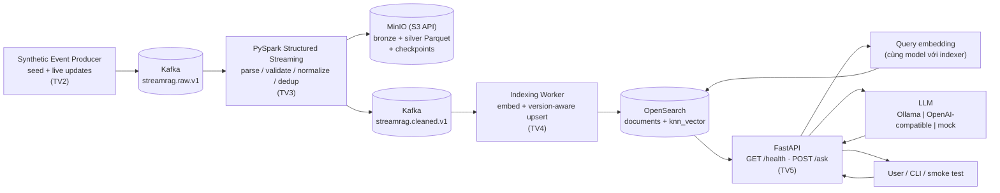

# StreamRAG — Kiến trúc hệ thống (Milestone 1)

> Owner: TV1 (Pham Chi Bang) · Trạng thái: **v1 — Gate A (27/10/2026)** · Quyết định nền: [ADR 0001](adr/0001-kappa-stack.md)
> Tài liệu này mô tả kiến trúc **mục tiêu của M1**. Thành phần nào chưa merge vào `main` được đánh dấu *(planned)*.

## 1. Bài toán

Hệ thống hỏi đáp (RAG) trên **incident/status updates** của các dịch vụ giả lập (Atlas Search, Payment API, Data Gateway, ...). Thông báo mới và bản sửa đổi đến **liên tục** qua stream; câu trả lời phải dựa trên **phiên bản mới nhất** mà không cần restart hay rebuild index thủ công.

Khác với RAG truyền thống (nạp tài liệu một lần rồi truy vấn), StreamRAG coi dữ liệu là một **dòng sự kiện vô hạn**: mỗi sự kiện mới đi qua pipeline xử lý streaming và trở nên truy vấn được sau một độ trễ **đo được** (*near-real-time*, không phải tức thì).

## 2. Vì sao Kappa

| Tiêu chí | Kappa (chọn) | Lambda |
|---|---|---|
| Số đường xử lý | 1 đường streaming | Batch layer + speed layer + serving merge |
| Logic transform | Viết 1 lần (Spark Structured Streaming) | Viết 2 lần, dễ lệch nhau |
| Tái tạo dữ liệu | Replay Kafka (trong retention) qua cùng job | Chạy lại batch layer |
| Phù hợp dữ liệu | Sự kiện ngắn, cần freshness | Phân tích lịch sử lớn |
| Độ phức tạp M1 | Thấp hơn | Cao, không cần thiết |

Kafka là **event log nguồn sự thật** của pipeline; mọi store downstream (Parquet, OpenSearch) là *materialized view* có thể dựng lại bằng replay. Chi tiết trade-off: [ADR 0001](adr/0001-kappa-stack.md).

## 3. Component diagram



| Thành phần | Công nghệ | Owner | Trạng thái |
|---|---|---|---|
| Event producer / simulator | Python | TV2 | *(planned)* |
| Event broker | Apache Kafka 3.9 (KRaft, không ZooKeeper) | TV1 (hạ tầng), TV2 (topics) | Compose |
| Stream processor | PySpark Structured Streaming | TV3 | *(planned)* |
| Data lake | MinIO (S3-compatible), Parquet | TV1 (hạ tầng), TV3 (layout) | Compose |
| Search / NoSQL store | OpenSearch 2.19 (document + vector) | TV1 (hạ tầng), TV4 (index) | Compose |
| Indexer | Python + sentence-transformers | TV4 | *(planned)* |
| API | FastAPI | TV5 | *(planned)* |
| LLM | Ollama hoặc API OpenAI-compatible; `mock` cho test | TV5 | *(planned)* |

## 4. Data flow

### 4.1. Write / ingestion path

1. **Producer** (TV2) publish JSON event lên `streamrag.raw.v1`, **key = `document_id`**, gán `ingested_at` (UTC).
2. **Spark** (TV3) đọc raw topic theo micro-batch (`trigger` ~5s):
   - ghi **bronze** (raw value + Kafka metadata) → `s3a://<LAKE_BUCKET>/bronze/events/ingest_date=YYYY-MM-DD/`;
   - parse theo schema, loại bản ghi lỗi (đếm, không crash), chuẩn hóa text/timestamp, dedup theo `event_id` (có watermark);
   - ghi **silver** → `s3a://<LAKE_BUCKET>/silver/events/ingest_date=YYYY-MM-DD/`;
   - publish bản sạch (+ `processed_at`) lên `streamrag.cleaned.v1`, key = `document_id`.
3. **Indexer** (TV4) consume cleaned topic, tính embedding của `title + "\n" + body`, **upsert** vào OpenSearch với `_id = document_id`, chỉ ghi khi `version` mới hơn bản đang có; thêm `indexed_at`.

### 4.2. Read / query path

1. Client gọi `POST /ask {"question": ..., "top_k": 3}`.
2. API encode câu hỏi bằng **cùng embedding model** với indexer → kNN top-k trên OpenSearch.
3. Ghép context (title, body, event_time, version) → grounded prompt → LLM.
4. Trả `answer`, `sources[]` (`document_id`, `version`, `title`, `event_time`, `score`), `retrieval_ms`. Context rỗng → không gọi LLM, trả "không đủ thông tin".

### 4.3. Sequence: "event mới → câu trả lời được cập nhật"

```mermaid
sequenceDiagram
    autonumber
    participant Sim as stream_simulator (TV2)
    participant Raw as Kafka raw.v1
    participant Spark as Spark job (TV3)
    participant Lake as MinIO Parquet
    participant Clean as Kafka cleaned.v1
    participant Idx as Indexer (TV4)
    participant OS as OpenSearch
    participant API as FastAPI /ask (TV5)
    participant LLM as LLM
    participant User as User / smoke test

    Note over OS: inc-atlas-001 v1: "maintenance at 20:30 UTC"
    Sim->>Raw: inc-atlas-001 v2 "changed to 21:30 UTC" (ingested_at)
    Raw->>Spark: micro-batch
    Spark->>Lake: bronze + silver Parquet
    Spark->>Clean: cleaned event (processed_at)
    Clean->>Idx: consume
    Idx->>OS: upsert _id=inc-atlas-001, version=2 (indexed_at)
    Note over OS: v1 bị thay thế; v1 tới muộn sẽ bị từ chối
    User->>API: "What is the latest Atlas Search maintenance time?"
    API->>OS: kNN top-k
    OS-->>API: inc-atlas-001 v2
    API->>LLM: grounded prompt + context v2
    LLM-->>API: "21:30 UTC"
    API-->>User: answer + sources[v2] (first_visible_at)
```

## 5. Contracts

| Contract | Giá trị M1 | Owner | Tài liệu chi tiết |
|---|---|---|---|
| Event payload | JSON, `schema_version: 1` (mục 3.2 plan) | TV2 | `data/contracts/event.schema.json`, `docs/data_contract.md` *(planned)* |
| Raw topic | `streamrag.raw.v1`, 3 partitions, RF 1, key `document_id` | TV2 | `infra/kafka/` *(planned)* |
| Cleaned topic | `streamrag.cleaned.v1`, 3 partitions, RF 1, key `document_id` | TV3 | README `services/stream_processor/` *(planned)* |
| Lake bucket | `streamrag-lake` (`bronze/`, `silver/`, `checkpoints/`) | TV1 / TV3 | mục 6 |
| Search index | `streamrag-docs-v1`, `knn_vector` dimension = `EMBEDDING_DIM` | TV4 | `infra/opensearch/index_mapping.json` *(planned)* |
| Embedding | đề xuất `sentence-transformers/all-MiniLM-L6-v2`, dim 384 | TV4 | `services/indexer/` *(planned)* |
| API | `GET /health`, `POST /ask` (mục 9 plan) | TV5 | `docs/api_contract.md` *(planned)* |

Mọi giá trị cấu hình nằm trong [`.env.example`](../.env.example). **Freeze v1 vào D8 (02/11)**; thay đổi breaking phải cập nhật contract + tests trong cùng PR và báo mọi owner.

### Ports (local)

| Service | Từ host | Trong network Compose |
|---|---|---|
| Kafka | `localhost:9092` | `kafka:29092` |
| MinIO S3 API | `localhost:9000` | `minio:9000` |
| MinIO console | `localhost:9001` | — |
| OpenSearch | `localhost:9200` | `opensearch:9200` |
| API *(planned)* | `localhost:8000` | `api:8000` |
| Spark UI *(planned)* | `localhost:4040` | — |

## 6. Storage strategy

| Tầng | Nơi lưu | Nội dung | Mục đích |
|---|---|---|---|
| Event log | Kafka raw/cleaned (retention mặc định 7 ngày) | Toàn bộ sự kiện theo thứ tự trong partition | Nguồn sự thật, replay |
| Bronze | MinIO `bronze/events/`, Parquet, partition `ingest_date` | Raw value + topic/partition/offset/timestamp | Audit, debug, reprocess |
| Silver | MinIO `silver/events/`, Parquet, partition `ingest_date` | Bản đã validate/normalize/dedup | Phân tích, nguồn cho batch/ML sau này |
| Checkpoint | MinIO `checkpoints/<query>/` | Offset + state của Spark | Restart không mất/không xử lý lại |
| Serving | OpenSearch `streamrag-docs-v1` | 1 document = 1 chunk, bản `version` mới nhất + vector | Retrieval cho RAG |

## 7. Delivery semantics và failure modes

Pipeline M1 là **at-least-once**. Ghi Parquet và ghi Kafka cleaned **không** nằm trong một distributed transaction, nên một micro-batch retry có thể ghi lặp. Tính đúng ở tầng serving dựa vào:

- `event_id` duy nhất → dedup trong Spark (trong phạm vi watermark);
- `_id = document_id` + external versioning ở OpenSearch → upsert **idempotent** và **không bị version cũ ghi đè**.

Chúng tôi **không tuyên bố exactly-once end-to-end** ở M1.

| Lỗi | Hành vi mong đợi | Ai xử lý |
|---|---|---|
| Message JSON/schema lỗi | Bỏ qua, đếm, log; stream tiếp tục | TV3 |
| Kafka re-delivery / producer retry | Dedup theo `event_id`; nếu lọt → upsert idempotent | TV3, TV4 |
| Version cũ tới sau version mới | OpenSearch trả 409 → no-op | TV4 |
| Spark job chết / restart | Tiếp tục từ checkpoint | TV3 |
| Indexer chết giữa chừng | Offset chỉ commit sau khi ghi thành công → xử lý lại, idempotent | TV4 |
| OpenSearch tạm không sẵn sàng | Retry có giới hạn + backoff | TV4 |
| LLM timeout / lỗi | API trả lỗi rõ ràng, không treo | TV5 |
| Indexing chậm | Câu trả lời tạm thời dựa trên bản cũ → đo bằng freshness | TV5 |

## 8. Freshness

Mỗi event mang các mốc thời gian (UTC): `event_time` (xảy ra) → `ingested_at` (producer) → `processed_at` (Spark) → `indexed_at` (indexer) → `first_visible_at` (lần đầu `/ask` trả về event đó, đo bởi smoke test).

**freshness = `first_visible_at - ingested_at`**. Mục tiêu tham khảo p95 ≤ 60s trên cấu hình đã ghi — **chưa phải kết quả đo**; số đo thật sẽ có trong `docs/milestone_1_evidence.md`.

## 9. Deployment

| | Local (M1) | Target (milestone sau) |
|---|---|---|
| Orchestration | Docker Compose ([`infra/compose.yaml`](../infra/compose.yaml)) + Makefile | Kubernetes / Cloud |
| Kafka | 1 broker KRaft, RF 1 | Cluster ≥ 3 broker, RF 3 (ví dụ Strimzi operator hoặc managed Kafka) |
| Spark | `local[*]` trong container | Spark on K8s (spark-submit/operator) hoặc managed Spark |
| Object storage | MinIO single node (**không** chứng minh lưu trữ phân tán) | HDFS / MinIO distributed / S3 cloud — xác nhận với giảng viên |
| OpenSearch | 1 node, security plugin **tắt** (chỉ cho local) | Cluster nhiều node, bật security |

Roadmap: [`deploy/k8s/README.md`](../deploy/k8s/README.md).

## 10. Giới hạn của M1

- Near-real-time (độ trễ vài giây đến vài chục giây), không phải tức thì.
- At-least-once; không chứng minh exactly-once.
- 1 document = 1 chunk; chỉ `operation = upsert` (chưa có delete/tombstone).
- Single-node cho mọi store; Docker Compose không thay thế yêu cầu K8s/Cloud của toàn đồ án.
- Image MinIO dùng bản fork cộng đồng `pgsty/minio` vì image `minio/minio` chính thức không còn được phát hành (xem ADR 0001).
- Máy dev 8 GB RAM: Docker Desktop nên được cấp ≥ 6 GB khi chạy full stack; mức RAM thực tế sẽ được đo và ghi vào evidence.
